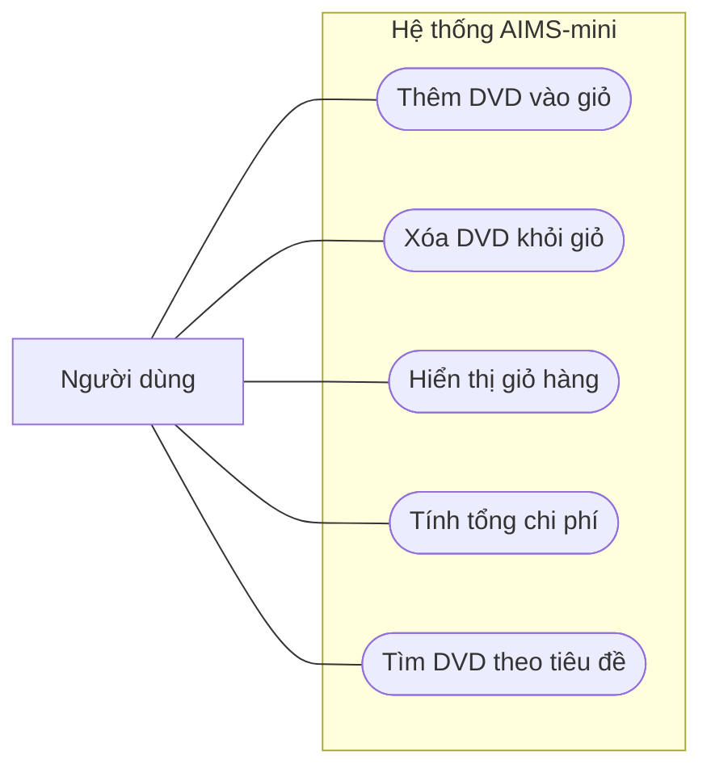

# AIMS-mini – Use Case Diagram

## 1. Giới thiệu

AIMS-mini là chương trình Python mô phỏng việc quản lý giỏ hàng DVD. Hệ thống hỗ trợ thêm, xóa, hiển thị DVD, tính tổng chi phí và tìm kiếm DVD theo tiêu đề.

## 2. Tác nhân

**Người dùng:** Tác nhân tương tác với các chức năng quản lý giỏ hàng.

Lưu ý: Đây là mô hình use case ở mức khái niệm. Phiên bản AIMS-mini hiện tại chạy các thao tác qua mã Python và chương trình demo, chưa có giao diện tương tác trực tiếp.

## 3. Sơ đồ Use Case

*Sơ đồ minh họa các ca sử dụng bằng Mermaid flowchart.*

## 4. Mô tả các Use Case

### UC01 – Thêm DVD vào giỏ hàng
- Mục tiêu: Thêm một DVD vào giỏ hàng.
- Tiền điều kiện: Đã khởi tạo giỏ hàng và có đối tượng DVD.
- Luồng chính: Gọi `Cart.add_dvd(dvd)` để thêm DVD.
- Kết quả: DVD được lưu trong danh sách `items`.

### UC02 – Xóa DVD khỏi giỏ hàng
- Mục tiêu: Loại bỏ một DVD khỏi giỏ hàng.
- Tiền điều kiện: DVD cần xóa tồn tại trong giỏ hàng.
- Luồng chính: Gọi `Cart.remove_dvd(dvd)`.
- Kết quả: DVD được loại khỏi giỏ hàng.

### UC03 – Hiển thị giỏ hàng
- Mục tiêu: Hiển thị danh sách DVD và giá của từng DVD.
- Luồng chính: Gọi `Cart.print_cart()`.
- Luồng thay thế: Nếu giỏ hàng rỗng, in `The cart is empty`.
- Kết quả: Thông tin giỏ hàng được hiển thị.

### UC04 – Tính tổng chi phí
- Mục tiêu: Tính tổng giá trị các DVD trong giỏ.
- Luồng chính: Gọi `Cart.total_cost()`.
- Kết quả: Trả về tổng chi phí.

### UC05 – Tìm kiếm DVD theo tiêu đề
- Mục tiêu: Tìm các DVD có tiêu đề chứa từ khóa.
- Luồng chính: Gọi `search_by_title(cart, keyword)`.
- Quy tắc: Không phân biệt chữ hoa và chữ thường.
- Luồng thay thế: Trả về danh sách rỗng nếu không có kết quả hoặc từ khóa rỗng.
- Kết quả: Trả về danh sách DVD phù hợp.
